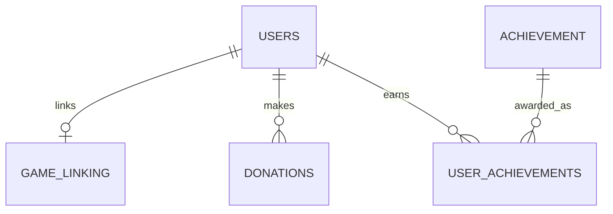
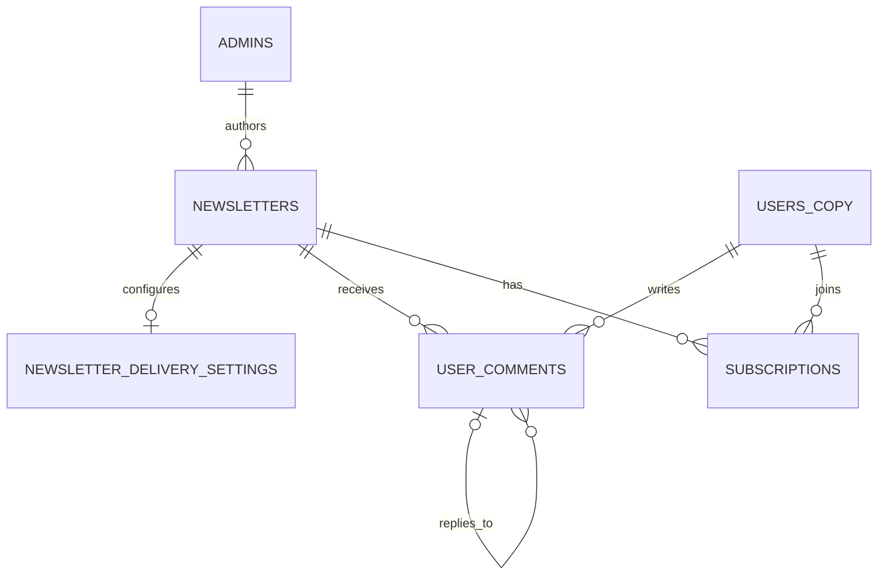
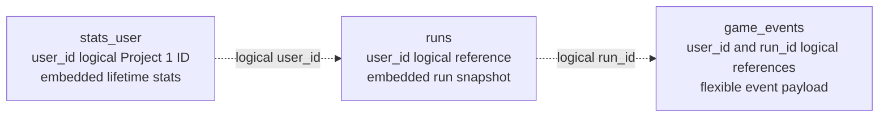

# Lab 01 data model

These are three separate databases. Relationships shown inside a database are
enforced locally; IDs shared between database contexts are logical references,
not foreign keys.

## Project 1 — Accounts and game identity (PostgreSQL)

`game_linking.user_id` is both PK and FK, giving the dependent 1:1. Donations
are 1:N. `user_achievements` is the M:N junction and retains unlock timestamps.
Provider payment IDs and usernames/emails are unique; user deletion is soft.

## Project 2 — Newsletter publishing (PostgreSQL)

Delivery settings use newsletter_id as both PK and FK (1:1). Admins own many
newsletters and newsletters receive many comments (1:N). `subscriptions` is
the M:N junction and carries consent, status, email snapshot, and unsubscribe
token. `users_copy.user_id` is a Project 1 logical ID, not a foreign key.

## Project 3 — Player statistics (MongoDB)

Lifetime statistics embed bounded categories (totals, enemies, progress, items).
Runs embed current-stat snapshots while retaining logical user references.
Events reference users/runs and permit event-specific payload fields. The
`player_snapshot` in a run is denormalized read data; Project 1 remains owner of
account identity.
