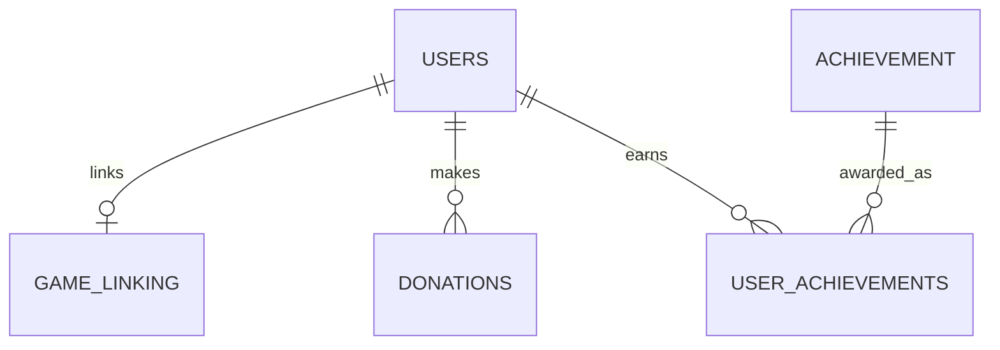
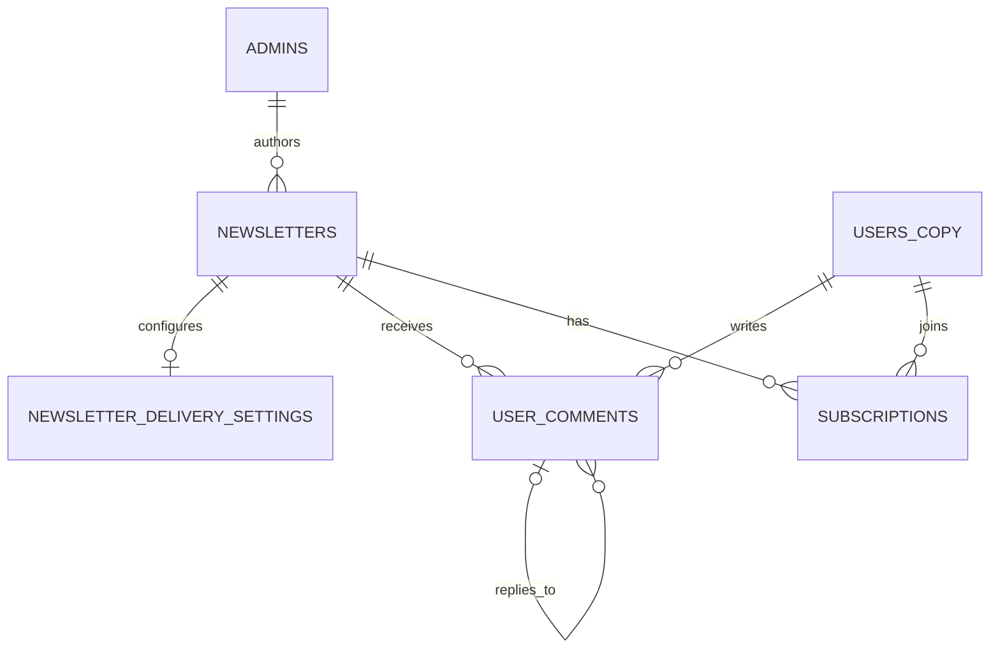
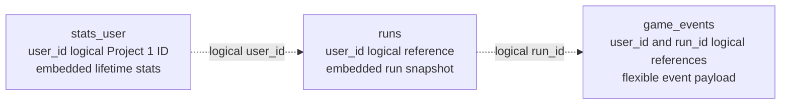

# Lab 01 data model

These are three separate databases. Relationships shown inside a database are
enforced locally; IDs shared between database contexts are logical references,
not foreign keys.

## Project 1 — Accounts and game identity (PostgreSQL)

`game_linking.user_id` is both PK and FK, giving the dependent 1:1. Donations
are 1:N. `user_achievements` is the M:N junction and retains unlock timestamps.
Provider payment IDs and usernames/emails are unique; user deletion is soft.
The donation state procedure locks the selected row, checks its expected
`row_version`, validates the transition, updates audit fields, and is atomic
when called in a PostgreSQL transaction (`BEGIN; CALL ...; COMMIT;`).
Custom indexes are documented in the schema for account lookup, achievement
lookup, donor history, and the completed non-anonymous donor leaderboard.

## Project 2 — Newsletter publishing (PostgreSQL)

Delivery settings use newsletter_id as both PK and FK (1:1). Admins own many
newsletters and newsletters receive many comments (1:N). `subscriptions` is
the M:N junction and carries consent, status, email snapshot, and unsubscribe
token. `users_copy.user_id` is a Project 1 logical ID, not a foreign key.
The six entities are admins, newsletters, delivery settings, account read
copies, comments, and subscriptions. Soft-deleted newsletter and comment rows
remain available for moderation/audit; `row_version` protects mutable records.
Indexes support the public feed, per-admin editorial history, comment threads,
and subscriber delivery selection; their purposes are documented in the DDL.

## Project 3 — Player statistics (MongoDB)

Lifetime statistics embed bounded categories (totals, enemies, progress, items).
Runs embed current-stat snapshots while retaining logical user references.
Events reference users/runs and permit event-specific payload fields. The
`player_snapshot` in a run is denormalized read data; Project 1 remains owner of
account identity. The embedded lifetime-stat categories are bounded; individual
run documents embed the run's current-stat snapshot while referencing the user;
event payloads remain flexible and reference both user and run IDs.
`db/p3/examples.json` shows representative documents with optional fields, and
`db/p3/queries.js` demonstrates leaderboard and event-count aggregations. Indexes
enforce unique user/run/event keys and support per-user run history and event
timeline reads.

## Duplication and ownership

| Field | Stored in | Owner | Consistency policy |
| --- | --- | --- | --- |
| `users_copy.user_id`, `user_name`, `user_email`, `is_deleted`, `source_updated_at` | Project 2 SQL | Project 1 `users` | Account lifecycle events update the read copy eventually; `source_updated_at` tracks the source `updated_at`; Project 2 never edits these source fields. `user_id` is a logical reference, not a cross-database FK. |
| `stats_user.user_id`, `runs.user_id`, `game_events.user_id` | Project 3 MongoDB | Project 1 `users` | Logical references copied from account/game events; IDs are stable and are not independently edited. |
| `stats_user.user_whoami` | Project 3 MongoDB | Project 1 `users.user_whoami` | Read copy refreshed on identity-rotation events; MongoDB never owns or changes the identity. |
| `runs.player_snapshot.user_name`, `user_whoami` | Project 3 MongoDB | Project 1 `users` | Historical snapshot captured when a run starts; it intentionally does not change after profile edits. |
| `subscriptions.user_email_snapshot` | Project 2 SQL | Project 1 `users.user_email` (through the Project 2 read copy) | Captured at subscription consent time and retained as the delivery/consent snapshot after account email changes. |
| `stats_user.progress.achievements_got` | Project 3 MongoDB | Project 1 `user_achievements` and `achievement` | Projection updated from achievement-unlocked events; Project 1 remains canonical for unlock membership and achievement definitions. |
